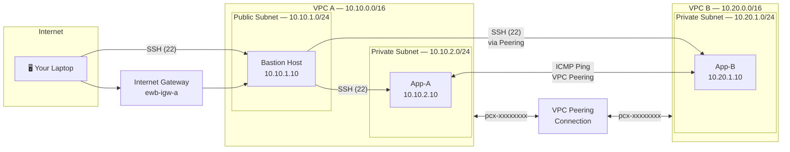

# AWS VPC Peering — Private Connectivity Between Two VPCs


## 📋 Project Overview

This project is part of the **EWB Cloud Labs** student curriculum. You will build a **VPC Peering** connection between two isolated AWS Virtual Private Clouds (VPCs), enabling private communication between instances without traversing the public internet.

### Objective

- Provision two VPCs with non-overlapping CIDR blocks.
- Deploy a **bastion host** in a public subnet for secure SSH access.
- Deploy application instances in **private subnets** across both VPCs.
- Establish a **VPC Peering Connection** and configure route tables and security groups to allow private cross-VPC traffic.
- Validate connectivity with ICMP ping and SSH tests.

---

## 🏗️ Architecture Diagram



---

## 📡 Network & IP Plan

| Resource           | Name Tag             | VPC / Subnet          | CIDR / IP         |
| ------------------- | -------------------- | --------------------- | ----------------- |
| VPC A              | `ewb-vpc-a`         | —                     | `10.10.0.0/16`    |
| Public Subnet A    | `ewb-a-public`      | VPC A                 | `10.10.1.0/24`    |
| Private Subnet A   | `ewb-a-private`     | VPC A                 | `10.10.2.0/24`    |
| VPC B              | `ewb-vpc-b`         | —                     | `10.20.0.0/16`    |
| Private Subnet B   | `ewb-b-private`     | VPC B                 | `10.20.1.0/24`    |
| Internet Gateway   | `ewb-igw-a`         | VPC A                 | —                 |
| Bastion Host       | `ewb-bastion`       | ewb-a-public          | `10.10.1.10`      |
| App-A Instance     | `ewb-app-a`         | ewb-a-private         | `10.10.2.10`      |
| App-B Instance     | `ewb-app-b`         | ewb-b-private         | `10.20.1.10`      |
| VPC Peering        | `ewb-peer-a-to-b`   | VPC A ↔ VPC B         | —                 |

---

## ✅ Prerequisites

| Requirement          | Details                                                  |
| -------------------- | -------------------------------------------------------- |
| **AWS Account**      | Free-tier eligible account with IAM permissions for VPC, EC2, and Peering |
| **Terraform**        | v1.5+ installed ([download](https://developer.hashicorp.com/terraform/downloads)) |
| **AWS CLI**          | v2 configured with `aws configure` ([install](https://docs.aws.amazon.com/cli/latest/userguide/getting-started-install.html)) |
| **SSH Client**       | OpenSSH (Linux/macOS built-in) or PuTTY (Windows)       |
| **Key Pair**         | An EC2 key pair (`.pem`) created in your target region   |

---

## 🚀 Quick Start

### Option A — Terraform Deployment

```bash
# Clone the repository
git clone <your-repo-url>
cd aws-vpc-peering-project/terraform

# Initialize Terraform
terraform init

# Preview the infrastructure
terraform plan -var="key_name=your-key-pair-name"

# Deploy
terraform apply -var="key_name=your-key-pair-name" -auto-approve

# Note the outputs (bastion public IP, private IPs)
terraform output
```

### Option B — CloudFormation Deployment

```bash
# Deploy the stack
aws cloudformation deploy \
  --template-file cloudformation/vpc-peering.yaml \
  --stack-name ewb-vpc-peering \
  --parameter-overrides KeyName=your-key-pair-name \
  --capabilities CAPABILITY_NAMED_IAM

# Get outputs
aws cloudformation describe-stacks \
  --stack-name ewb-vpc-peering \
  --query "Stacks[0].Outputs"
```

### Option C — Manual Console Deployment

Follow the detailed [Step-by-Step Guide](docs/STEP_BY_STEP_GUIDE.md) for a full AWS Console walkthrough.

---

## 🔐 Security Groups

### `ewb-sg-bastion` — Bastion Host (VPC A)

| Rule # | Type  | Protocol | Port | Source        | Description           |
| ------ | ----- | -------- | ---- | ------------- | --------------------- |
| 1      | SSH   | TCP      | 22   | `0.0.0.0/0`  | SSH from your laptop  |

### `ewb-sg-app-a` — App-A Instance (VPC A)

| Rule # | Type  | Protocol | Port | Source              | Description                |
| ------ | ----- | -------- | ---- | ------------------- | -------------------------- |
| 1      | SSH   | TCP      | 22   | `ewb-sg-bastion`   | SSH from Bastion           |
| 2      | ICMP  | ICMP     | All  | `10.20.0.0/16`     | Ping from VPC B            |

### `ewb-sg-app-b` — App-B Instance (VPC B)

| Rule # | Type  | Protocol | Port | Source              | Description                |
| ------ | ----- | -------- | ---- | ------------------- | -------------------------- |
| 1      | SSH   | TCP      | 22   | `10.10.0.0/16`     | SSH from VPC A (Bastion)   |
| 2      | ICMP  | ICMP     | All  | `10.10.0.0/16`     | Ping from VPC A            |

---

## 🛣️ Route Tables

### `ewb-rt-a-public` — Public Route Table (VPC A)

| Destination      | Target                    | Notes                    |
| ---------------- | ------------------------- | ------------------------ |
| `10.10.0.0/16`   | local                     | VPC A local traffic      |
| `0.0.0.0/0`      | `ewb-igw-a`              | Internet access          |
| `10.20.0.0/16`   | `pcx-xxxxxxxx` (peering) | Route to VPC B           |

### `ewb-rt-a-private` — Private Route Table (VPC A)

| Destination      | Target                    | Notes                    |
| ---------------- | ------------------------- | ------------------------ |
| `10.10.0.0/16`   | local                     | VPC A local traffic      |
| `10.20.0.0/16`   | `pcx-xxxxxxxx` (peering) | Route to VPC B           |

### `ewb-rt-b-private` — Private Route Table (VPC B)

| Destination      | Target                    | Notes                    |
| ---------------- | ------------------------- | ------------------------ |
| `10.20.0.0/16`   | local                     | VPC B local traffic      |
| `10.10.0.0/16`   | `pcx-xxxxxxxx` (peering) | Route to VPC A           |

---

## 🧪 Testing & Validation

Run all five tests **after** VPC peering is established and routes are configured.

### Test 1 — Baseline Failure (Before Peering)

```bash
# From App-A, attempt to ping App-B (should FAIL — no peering yet)
[ec2-user@app-a ~]$ ping -c 4 10.20.1.10
# Expected: 100% packet loss
```

### Test 2 — Forward Ping (App-A → App-B)

```bash
# After peering is active, from App-A:
[ec2-user@app-a ~]$ ping -c 4 10.20.1.10
# Expected: 0% packet loss, replies from 10.20.1.10
```

### Test 3 — Reverse Ping (App-B → App-A)

```bash
# From App-B:
[ec2-user@app-b ~]$ ping -c 4 10.10.2.10
# Expected: 0% packet loss, replies from 10.10.2.10
```

### Test 4 — SSH to App-B via Bastion

```bash
# From your laptop, using ProxyJump:
ssh -J ec2-user@<bastion-public-ip> ec2-user@10.20.1.10
# Expected: Successful login to App-B
```

### Test 5 — Isolation Check (App-B Cannot Reach Internet)

```bash
# From App-B:
[ec2-user@app-b ~]$ ping -c 4 8.8.8.8
# Expected: 100% packet loss (no IGW/NAT in VPC B)
```

---

## 🔑 SSH Configuration

Add this to your `~/.ssh/config` for convenient access:

```ssh-config
# --- Bastion Host ---
Host bastion
    HostName <BASTION_PUBLIC_IP>
    User ec2-user
    IdentityFile ~/.ssh/your-key.pem
    StrictHostKeyChecking no

# --- App-A (via Bastion) ---
Host app-a
    HostName 10.10.2.10
    User ec2-user
    IdentityFile ~/.ssh/your-key.pem
    ProxyJump bastion
    StrictHostKeyChecking no

# --- App-B (via Bastion, cross-VPC) ---
Host app-b
    HostName 10.20.1.10
    User ec2-user
    IdentityFile ~/.ssh/your-key.pem
    ProxyJump bastion
    StrictHostKeyChecking no
```

Then simply run:

```bash
ssh bastion    # Connect to bastion
ssh app-a      # Jump to App-A
ssh app-b      # Jump to App-B (cross-VPC via peering)
```

---

## 🧹 Cleanup

> [!CAUTION]
> Always clean up resources to avoid unexpected AWS charges.

### Terraform

```bash
cd terraform/
terraform destroy -var="key_name=your-key-pair-name" -auto-approve
```

### CloudFormation

```bash
aws cloudformation delete-stack --stack-name ewb-vpc-peering
```

### Manual Console Cleanup (in order)

1. **Terminate** all three EC2 instances
2. **Delete** VPC Peering Connection
3. **Delete** Security Groups (ewb-sg-bastion, ewb-sg-app-a, ewb-sg-app-b)
4. **Delete** Subnets
5. **Detach & Delete** Internet Gateway
6. **Delete** Route Tables (non-main)
7. **Delete** VPC A and VPC B
8. **Delete** Key Pair (if no longer needed)

---

## 📁 Project Structure

```
aws-vpc-peering-project/
├── README.md                        # This file
├── LICENSE                          # MIT License
├── .gitignore                       # Git ignore rules
├── docs/
│   ├── STEP_BY_STEP_GUIDE.md       # Console walkthrough
│   └── ARCHITECTURE.md             # Architecture deep dive
├── terraform/
│   ├── main.tf                     # Root module
│   ├── variables.tf                # Input variables
│   ├── outputs.tf                  # Output values
│   ├── providers.tf                # Provider configuration
│   ├── vpc-a.tf                    # VPC A resources
│   ├── vpc-b.tf                    # VPC B resources
│   ├── peering.tf                  # VPC peering connection & routes
│   ├── security-groups.tf          # Security group definitions
│   ├── ec2.tf                      # EC2 instances
│   └── terraform.tfvars.example    # Example variable values
├── cloudformation/
│   └── vpc-peering.yaml            # CloudFormation template
└── screenshots/                    # Validation screenshots
    └── .gitkeep
```

---

## 📝 License

This project is licensed under the **MIT License** — see the [LICENSE](LICENSE) file for details.

---

## 👤 Author

| Field       | Value                    |
| ----------- | ------------------------ |
| **Name**    | Ankit Singh Yadav        |
| **GitHub**  | [@ankitsingyadav](https://github.com/ankitsingyadav) |
| **Program** | EWB Cloud Labs           |
| **Date**    | October 2026             |

---

> [!NOTE]
> This is a learning project designed for the EWB Cloud Labs curriculum. It demonstrates core AWS networking concepts including VPC isolation, peering, route propagation, security group rules, and the bastion host access pattern.
