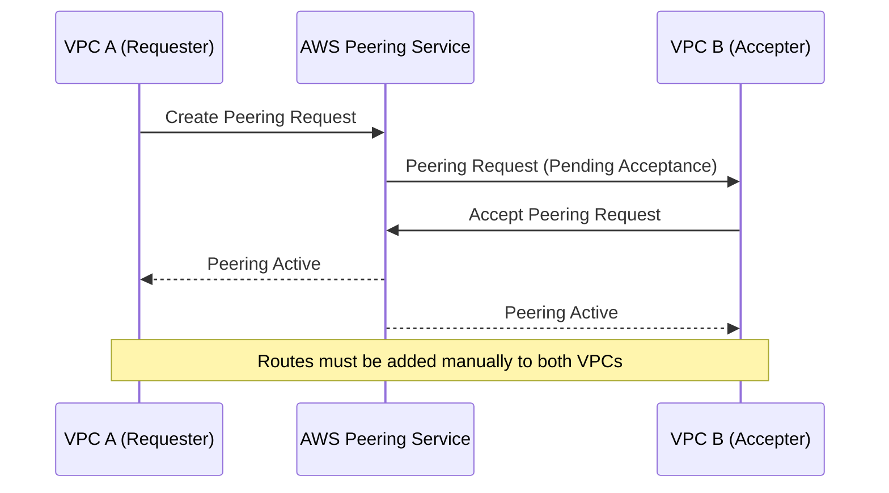
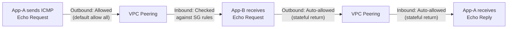
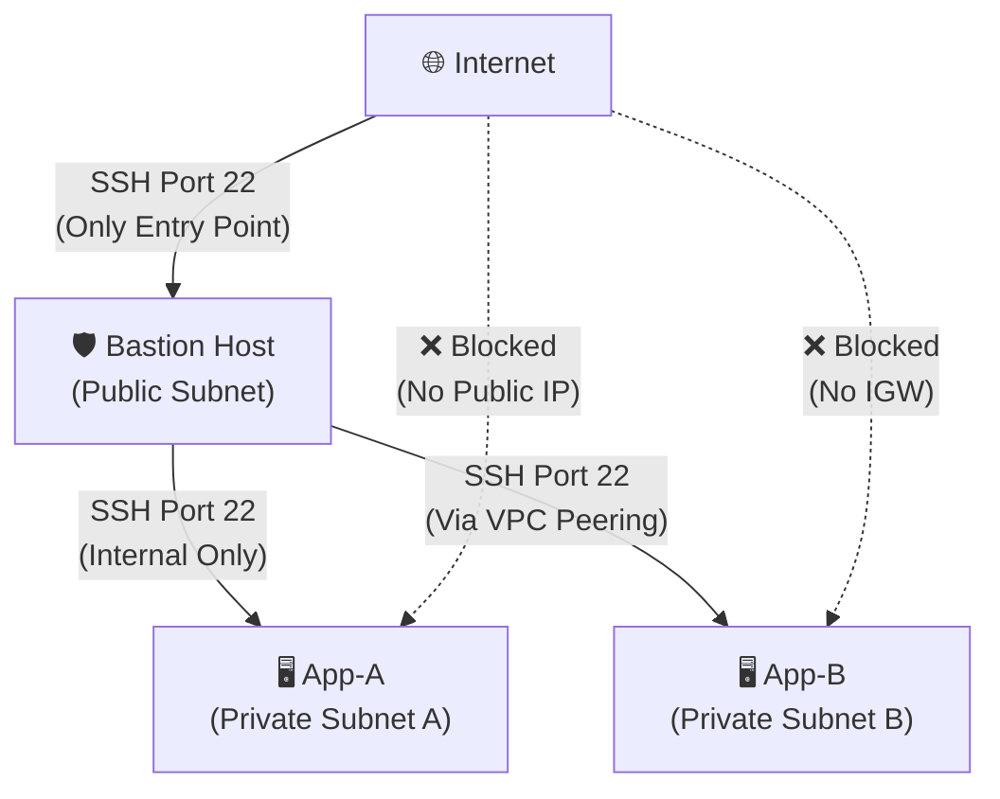
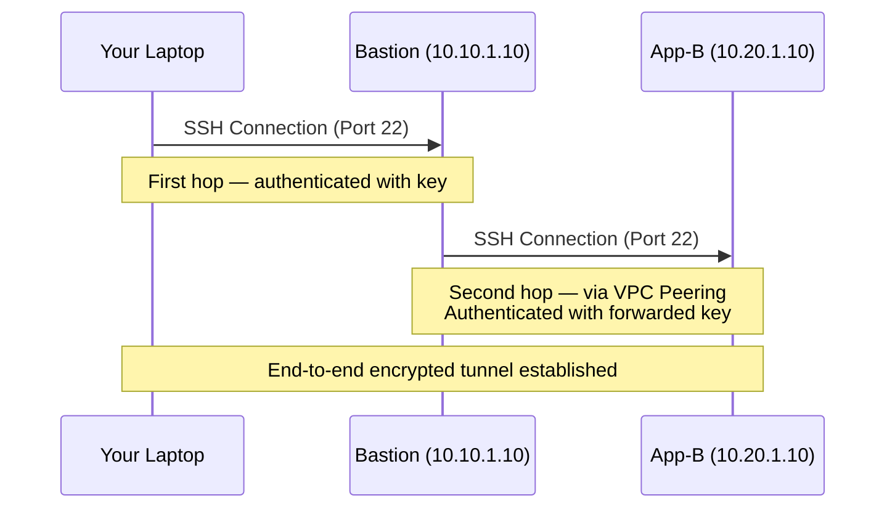
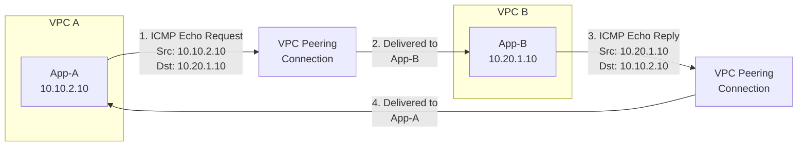
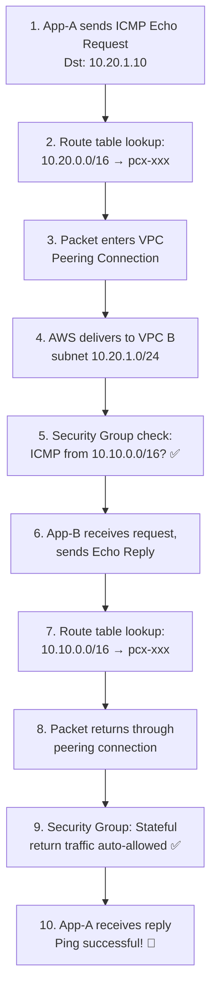
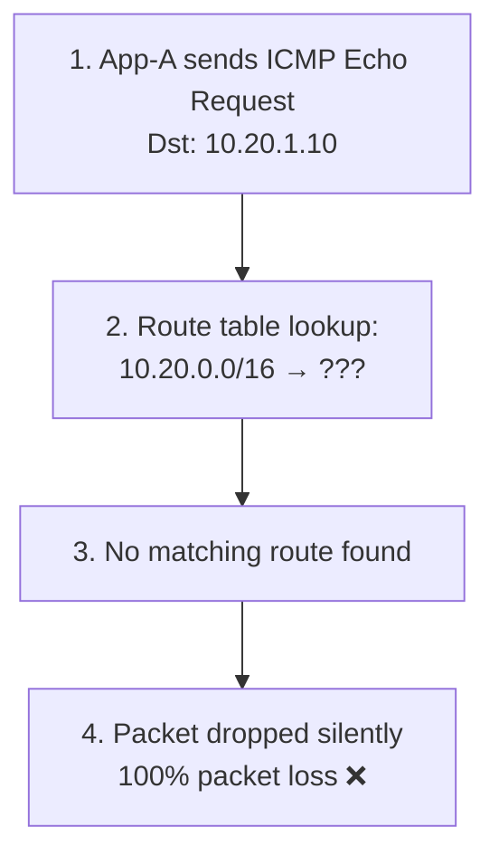

# 🏗️ Architecture Deep Dive — AWS VPC Peering

This document explains the core AWS networking concepts used in this project.

---

## Table of Contents

- [VPC Peering](#vpc-peering)
- [Non-Overlapping CIDRs](#non-overlapping-cidrs)
- [Route Tables](#route-tables)
- [Security Groups](#security-groups)
- [Bastion Host Pattern](#bastion-host-pattern)
- [SSH ProxyJump](#ssh-proxyjump)
- [ICMP — Echo Request & Reply](#icmp--echo-request--reply)
- [Architecture Flow](#architecture-flow)

---

## VPC Peering

A **VPC Peering Connection** is a networking link between two VPCs that enables private IPv4/IPv6 traffic to flow between them using Amazon's internal backbone network.

### Key Characteristics

| Property                 | Detail                                                    |
| ------------------------ | --------------------------------------------------------- |
| **Traffic path**         | AWS internal backbone (never traverses the public internet) |
| **Encryption**           | Traffic is encrypted in transit within the AWS network     |
| **Bandwidth**            | No single point of bandwidth bottleneck                   |
| **Cost**                 | Standard data transfer charges apply; no hourly fee       |
| **Scope**                | Same region or cross-region (inter-region peering)        |
| **Transitivity**         | ❌ **Not transitive** — if A↔B and B↔C, A cannot reach C via B |

### How It Works



### What Peering Does NOT Do

- **No transitive routing** — Traffic cannot hop through a peered VPC to reach a third VPC.
- **No edge-to-edge routing** — You cannot use a peered VPC's IGW, NAT Gateway, or VPN to reach the internet or on-premises networks.
- **No overlapping CIDRs** — Both VPCs must have non-overlapping IP ranges.

---

## Non-Overlapping CIDRs

For VPC peering to work, the CIDR blocks of the two VPCs **must not overlap**. If they did, the routing layer could not distinguish between local traffic and peered traffic.

### Our Design

```
VPC A:  10.10.0.0/16  →  10.10.0.0 – 10.10.255.255  (65,536 IPs)
VPC B:  10.20.0.0/16  →  10.20.0.0 – 10.20.255.255  (65,536 IPs)
```

These ranges are completely disjoint within the `10.0.0.0/8` private address space (RFC 1918), so there is zero overlap.

### Why /16?

A `/16` CIDR provides 65,536 IP addresses — far more than needed for this lab, but it follows a realistic enterprise pattern where each VPC represents a department, application environment, or region.

### Subnet Breakdown

```
VPC A (10.10.0.0/16)
├── ewb-a-public   10.10.1.0/24   (254 usable IPs)  — Bastion host
└── ewb-a-private  10.10.2.0/24   (254 usable IPs)  — App-A

VPC B (10.20.0.0/16)
└── ewb-b-private  10.20.1.0/24   (254 usable IPs)  — App-B
```

> [!NOTE]
> AWS reserves 5 IPs per subnet (first 4 + last), so a `/24` subnet yields 251 usable addresses, not 254.

---

## Route Tables

Route tables control where network traffic is directed. Every subnet must be associated with exactly one route table.

### How Route Lookup Works

When an instance sends a packet, AWS evaluates the route table associated with that instance's subnet. It uses **longest prefix match** — the most specific matching route wins.

### Route Tables in This Project

#### Public Route Table (`ewb-rt-a-public`)

```
Destination      → Target
──────────────────────────────
10.10.0.0/16     → local          (VPC A internal)
0.0.0.0/0        → igw-xxx        (Internet via IGW)
10.20.0.0/16     → pcx-xxx        (VPC B via peering)
```

- The `0.0.0.0/0` route makes this a **public** subnet — instances can reach the internet via the Internet Gateway.

#### Private Route Table (`ewb-rt-a-private`)

```
Destination      → Target
──────────────────────────────
10.10.0.0/16     → local          (VPC A internal)
10.20.0.0/16     → pcx-xxx        (VPC B via peering)
```

- **No** `0.0.0.0/0` route — instances in this subnet cannot initiate internet connections.

#### VPC B Route Table (`ewb-rt-b-private`)

```
Destination      → Target
──────────────────────────────
10.20.0.0/16     → local          (VPC B internal)
10.10.0.0/16     → pcx-xxx        (VPC A via peering)
```

- VPC B has **no Internet Gateway at all**, reinforcing complete isolation from the internet.

> [!IMPORTANT]
> Peering routes must be added to **both sides** of the connection. A common mistake is adding the route on only one side, resulting in asymmetric routing failure — packets go out but replies cannot come back.

---

## Security Groups

Security groups act as **virtual firewalls** at the instance (ENI) level. They are **stateful** — if you allow inbound traffic, the response is automatically allowed outbound.

### Stateful Behavior



### Security Group Design Principles

| Principle                     | Implementation in This Project                         |
| ----------------------------- | ------------------------------------------------------ |
| **Least privilege**           | Only open ports that are required (SSH, ICMP)          |
| **Source specificity**        | App-A allows SSH only from the bastion SG, not `0.0.0.0/0` |
| **Cross-VPC by CIDR**        | App-B references `10.10.0.0/16` since SGs can't cross VPC boundaries |
| **No outbound restrictions**  | Default outbound allows all (sufficient for this lab)  |

### Why App-B Uses CIDR Instead of SG Reference

Security groups can only reference other security groups **within the same VPC**. Since `ewb-sg-bastion` is in VPC A and `ewb-sg-app-b` is in VPC B, we use the VPC A CIDR block (`10.10.0.0/16`) as the source instead.

---

## Bastion Host Pattern

A **bastion host** (also called a jump box) is a hardened instance placed in a **public subnet** that acts as the sole entry point into private infrastructure.

### Why Use a Bastion?



### Benefits

| Benefit                  | Explanation                                                     |
| ------------------------ | --------------------------------------------------------------- |
| **Reduced attack surface** | Only one public IP exposed to the internet                    |
| **Centralized logging**   | All SSH sessions pass through one host — easier to audit      |
| **Network segmentation**  | Private instances never have public IPs                       |
| **Compliance**            | Meets security frameworks requiring controlled access points  |

### Hardening Best Practices (Production)

In production, you would also:
- Restrict SSH source to your specific IP (not `0.0.0.0/0`)
- Enable MFA for SSH access
- Use AWS Session Manager instead of SSH (no bastion needed)
- Enable VPC Flow Logs for auditing
- Set up CloudWatch alarms for unusual login patterns

---

## SSH ProxyJump

**ProxyJump** (`-J` flag) is an OpenSSH feature that allows you to SSH to a target host by automatically tunneling through an intermediate (jump) host.

### How It Works



### Command Comparison

```bash
# Without ProxyJump (manual two-step)
ssh -i ~/.ssh/key.pem ec2-user@<bastion-ip>        # Step 1: SSH to bastion
ssh -i ~/.ssh/key.pem ec2-user@10.20.1.10           # Step 2: SSH to App-B

# With ProxyJump (single command)
ssh -J ec2-user@<bastion-ip> ec2-user@10.20.1.10    # One step!

# With SSH config (even simpler)
ssh app-b                                            # Uses config aliases
```

### Security Note

ProxyJump does **not** place your private key on the bastion host. The SSH protocol uses **agent forwarding** or re-authentication directly from your laptop through the tunnel.

---

## ICMP — Echo Request & Reply

**ICMP** (Internet Control Message Protocol) is used for network diagnostics. The `ping` command sends **ICMP Echo Request** packets and listens for **ICMP Echo Reply** packets.

### Packet Flow Through VPC Peering



### ICMP Types Used in This Project

| Type | Code | Name          | Direction          | Purpose              |
| ---- | ---- | ------------- | ------------------ | -------------------- |
| 8    | 0    | Echo Request  | App-A → App-B      | "Are you there?"     |
| 0    | 0    | Echo Reply    | App-B → App-A      | "Yes, I'm here."     |

### Why We Allow "All ICMP" in Security Groups

While we only need types 0 and 8, allowing **All ICMP** also enables other useful diagnostic messages:

- **Type 3** — Destination Unreachable (helps debug routing)
- **Type 11** — Time Exceeded (used by `traceroute`)

> [!TIP]
> In production, restrict ICMP to only the types you need. For this lab, "All ICMP" is acceptable for simplicity.

---

## Architecture Flow

### Complete Data Flow — Ping Test



### What Happens When Peering Routes Are Missing



This is exactly what happens in the **baseline test** before peering is configured — the route table has no entry for `10.20.0.0/16`, so packets to VPC B are simply dropped.

---

## Summary of Concepts

| Concept              | Role in This Project                                        |
| -------------------- | ----------------------------------------------------------- |
| **VPC Peering**      | Creates a private link between VPC A and VPC B              |
| **Non-overlapping CIDRs** | Ensures unambiguous routing (10.10.x.x vs 10.20.x.x) |
| **Route Tables**     | Direct cross-VPC traffic to the peering connection          |
| **Security Groups**  | Control which protocols/ports are allowed through           |
| **Bastion Host**     | Single secure entry point from the internet                 |
| **SSH ProxyJump**    | Tunnels through bastion to reach private instances           |
| **ICMP**             | Validates connectivity with `ping`                          |

---

> [!NOTE]
> For further reading, see the official AWS documentation:
> - [VPC Peering Guide](https://docs.aws.amazon.com/vpc/latest/peering/what-is-vpc-peering.html)
> - [Security Groups](https://docs.aws.amazon.com/vpc/latest/userguide/VPC_SecurityGroups.html)
> - [Route Tables](https://docs.aws.amazon.com/vpc/latest/userguide/VPC_Route_Tables.html)
