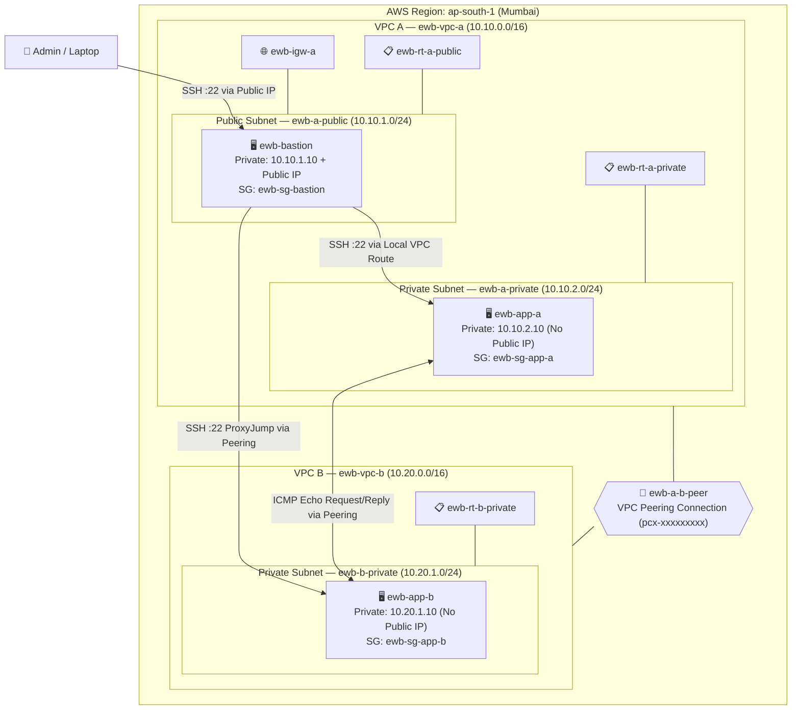

# AWS VPC Peering Project Report

### EWB Cloud Labs — AWS Architect Associate

---

## 1. Cover Page

| Field | Details |
|---|---|
| **Student Name** | Ankit Singh Yadav |
| **Batch** | AWS Cloud Architect Associate — Batch 2026 |
| **Project Title** | AWS VPC Peering — Private Cross-VPC Connectivity |
| **AWS Region** | ap-south-1 (Mumbai) |
| **Completion Date** | October 2026 |

---

## 2. Architecture Diagram & Resource Inventory

### 2.1 Architecture Diagram



### 2.2 Resource Inventory

| # | Resource Name | Type | Resource ID | IPv4 CIDR / Address | Notes |
|---|---|---|---|---|---|
| 1 | `ewb-vpc-a` | VPC | `[vpc-xxxxxxxxxxxxxxxxx]` | `10.10.0.0/16` | VPC A — houses public bastion and private App-A |
| 2 | `ewb-vpc-b` | VPC | `[vpc-xxxxxxxxxxxxxxxxx]` | `10.20.0.0/16` | VPC B — houses isolated private workload App-B |
| 3 | `ewb-a-public` | Subnet | `[subnet-xxxxxxxxxxxxxxxxx]` | `10.10.1.0/24` | Public subnet in VPC A (ap-south-1a) |
| 4 | `ewb-a-private` | Subnet | `[subnet-xxxxxxxxxxxxxxxxx]` | `10.10.2.0/24` | Private subnet in VPC A (ap-south-1a) |
| 5 | `ewb-b-private` | Subnet | `[subnet-xxxxxxxxxxxxxxxxx]` | `10.20.1.0/24` | Private subnet in VPC B (ap-south-1a) |
| 6 | `ewb-bastion` | EC2 (t3.micro) | `[i-xxxxxxxxxxxxxxxxx]` | `10.10.1.10` + Public IP | Admin bastion host with public IPv4 |
| 7 | `ewb-app-a` | EC2 (t3.micro) | `[i-xxxxxxxxxxxxxxxxx]` | `10.10.2.10` (No Public IP) | Private application workload A |
| 8 | `ewb-app-b` | EC2 (t3.micro) | `[i-xxxxxxxxxxxxxxxxx]` | `10.20.1.10` (No Public IP) | Private application workload B |
| 9 | `ewb-igw-a` | Internet Gateway | `[igw-xxxxxxxxxxxxxxxxx]` | — | Attached to VPC A only |
| 10 | `ewb-rt-a-public` | Route Table | `[rtb-xxxxxxxxxxxxxxxxx]` | — | Associated with `ewb-a-public` |
| 11 | `ewb-rt-a-private` | Route Table | `[rtb-xxxxxxxxxxxxxxxxx]` | — | Associated with `ewb-a-private` |
| 12 | `ewb-rt-b-private` | Route Table | `[rtb-xxxxxxxxxxxxxxxxx]` | — | Associated with `ewb-b-private` |
| 13 | `ewb-sg-bastion` | Security Group | `[sg-xxxxxxxxxxxxxxxxx]` | — | Allows SSH :22 from Admin Public IP (`var.my_ip/32`) |
| 14 | `ewb-sg-app-a` | Security Group | `[sg-xxxxxxxxxxxxxxxxx]` | — | Allows SSH from `10.10.1.10/32`, ICMP Echo from `10.20.1.10/32` |
| 15 | `ewb-sg-app-b` | Security Group | `[sg-xxxxxxxxxxxxxxxxx]` | — | Allows SSH from `10.10.1.10/32`, ICMP Echo from `10.10.2.10/32` |
| 16 | `ewb-a-b-peer` | VPC Peering Connection | `[pcx-xxxxxxxxxxxxxxxxx]` | — | Active peering link between VPC A ↔ VPC B |
| 17 | `ewb-lab` | EC2 Key Pair | `[key-xxxxxxxxxxxxxxxxx]` | — | RSA key pair for instance SSH access |

---

## 3. Subnet CIDRs & Route Tables

### 3.1 CIDR Allocation

| VPC / Subnet | CIDR Block | Purpose |
|---|---|---|
| `ewb-vpc-a` | `10.10.0.0/16` | VPC A — primary VPC with internet gateway |
| `ewb-a-public` | `10.10.1.0/24` | Public subnet — bastion host (admin entry point) |
| `ewb-a-private` | `10.10.2.0/24` | Private subnet — App-A workload (no public IP) |
| `ewb-vpc-b` | `10.20.0.0/16` | VPC B — isolated VPC, connected strictly via peering |
| `ewb-b-private` | `10.20.1.0/24` | Private subnet — App-B workload (no public IP) |

> [!NOTE]
> `10.10.0.0/16` and `10.20.0.0/16` do not overlap. AWS VPC peering requires completely non-overlapping CIDRs across requester and accepter VPCs.

### 3.2 Route Table: `ewb-rt-a-public`

> 📸 **Screenshot:** [INSERT: `ewb-rt-a-public` route table — Routes tab showing 3 routes + Subnet Associations tab showing `ewb-a-public`]

| Destination | Target | Purpose |
|---|---|---|
| `10.10.0.0/16` | `local` | Default local route — traffic within VPC A |
| `0.0.0.0/0` | `ewb-igw-a` | Default internet route for the bastion host |
| `10.20.0.0/16` | `ewb-a-b-peer` (`pcx-...`) | Routes traffic destined for VPC B over peering (Bastion → App-B via ProxyJump) |

### 3.3 Route Table: `ewb-rt-a-private`

> 📸 **Screenshot:** [INSERT: `ewb-rt-a-private` route table — Routes tab showing local & peering routes + Subnet Associations tab showing `ewb-a-private`]

| Destination | Target | Purpose |
|---|---|---|
| `10.10.0.0/16` | `local` | Default local route — traffic within VPC A |
| `10.20.0.0/16` | `ewb-a-b-peer` (`pcx-...`) | Routes forward traffic from App-A to VPC B workloads |

### 3.4 Route Table: `ewb-rt-b-private`

> 📸 **Screenshot:** [INSERT: `ewb-rt-b-private` route table — Routes tab showing local & return peering routes + Subnet Associations tab showing `ewb-b-private`]

| Destination | Target | Purpose |
|---|---|---|
| `10.20.0.0/16` | `local` | Default local route — traffic within VPC B |
| `10.10.0.0/16` | `ewb-a-b-peer` (`pcx-...`) | **Return path** to VPC A for App-B responses and reverse pings |

---

## 4. VPC Peering Connection

### 4.1 Peering Details

| Field | Value |
|---|---|
| **Peering Connection Name** | `ewb-a-b-peer` |
| **Peering Connection ID** | `[pcx-xxxxxxxxxxxxxxxxx]` |
| **Status** | Active |
| **Requester VPC** | `ewb-vpc-a` (`[vpc-xxxxxxxxx]`) — `10.10.0.0/16` |
| **Accepter VPC** | `ewb-vpc-b` (`[vpc-xxxxxxxxx]`) — `10.20.0.0/16` |
| **Region** | ap-south-1 (Mumbai) |

> 📸 **Screenshot:** [INSERT: Peering Connections console showing `ewb-a-b-peer`, Active status, requester & accepter VPC IDs and CIDRs]

### 4.2 Why Is Acceptance Required Even in the Same Account?

VPC peering follows an explicit **request–accept model** regardless of whether VPCs belong to the same AWS account or across accounts:
1. **Security boundaries** — AWS treats every VPC as an isolated administrative domain.
2. **Preventing unauthorized connectivity** — In real-world enterprise accounts, different VPCs often belong to distinct environments (Production, Staging, Development) or departments. Requiring explicit acceptance prevents accidental or unauthorized network bridges.
3. **Audit trail** — Creates distinct CloudTrail events for both the request and acceptance steps.

---

## 5. Security Group Rules

### 5.1 `ewb-sg-bastion` — Inbound Rules

| # | Type | Protocol | Port Range | Source | Description |
|---|---|---|---|---|---|
| 1 | SSH | TCP | 22 | `[YOUR_PUBLIC_IP]/32` | Allow admin SSH from your local machine |

### 5.2 `ewb-sg-app-a` — Inbound Rules

| # | Type | Protocol | Port Range | Source | Description |
|---|---|---|---|---|---|
| 1 | SSH | TCP | 22 | `10.10.1.10/32` | Allow SSH only from bastion private IP |
| 2 | Custom ICMP - IPv4 | ICMP | Type 8 (Echo Request) | `10.20.1.10/32` | Allow ping replies/requests from App-B |

### 5.3 `ewb-sg-app-b` — Inbound Rules

| # | Type | Protocol | Port Range | Source | Description |
|---|---|---|---|---|---|
| 1 | SSH | TCP | 22 | `10.10.1.10/32` | Allow SSH only from bastion private IP |
| 2 | Custom ICMP - IPv4 | ICMP | Type 8 (Echo Request) | `10.10.2.10/32` | Allow ping requests from App-A |

> 📸 **Screenshot:** [INSERT: Inbound rules for `ewb-sg-bastion`]

> 📸 **Screenshot:** [INSERT: Inbound rules for `ewb-sg-app-a`]

> 📸 **Screenshot:** [INSERT: Inbound rules for `ewb-sg-app-b`]

### 5.4 Why Use `/32` Source Rules?

A `/32` CIDR mask specifies an exact single IPv4 host address. By using `10.10.1.10/32`, we restrict inbound SSH exclusively to the designated bastion host, preventing any other host in the public subnet from accessing private instances. This enforces the **principle of least privilege**.

### 5.5 Why ICMP Type 8 (Echo Request)?

ICMP does not use port numbers; it uses types and codes:
- **Type 8, Code 0** corresponds to an **Echo Request** (ping query).
- **Type 0, Code 0** corresponds to an **Echo Reply** (ping response).

Because AWS Security Groups are **stateful**, permitting inbound Type 8 automatically allows the outbound Type 0 reply back to the sender. Restricting the rule to Type 8 rather than "All ICMP" prevents unnecessary exposure to other ICMP messages (like redirect or router solicitation).

---

## 6. Test Results

### Test 01: Baseline Failure — Ping Before Peering Routes

> 📸 **Screenshot:** [INSERT: Terminal showing `ping -c 4 10.20.1.10` from App-A with 100% packet loss BEFORE routes are added]

**What's happening:** Although the peering connection may be Active, the VPC route tables contain no target for `10.20.0.0/16`. Packets sent by App-A are dropped immediately by the VPC router. This proves that **peering activation alone is insufficient — explicit route entries are mandatory**.

**Terminal Output:**
```
[ec2-user@ewb-app-a ~]$ ping -c 4 10.20.1.10
PING 10.20.1.10 (10.20.1.10) 56(84) bytes of data.
--- 10.20.1.10 ping statistics ---
4 packets transmitted, 0 received, 100% packet loss, time 3003ms
```

---

### Test 02: Forward Ping — App-A → App-B (After Routes)

> 📸 **Screenshot:** [INSERT: Terminal showing successful `ping -c 4 10.20.1.10` from App-A with 0% packet loss]

**What's happening:** With peering routes added in both route tables and security groups properly configured:
- Forward path: App-A (`10.10.2.10`) → `ewb-rt-a-private` (`10.20.0.0/16 → pcx-...`) → Peering Link → `ewb-vpc-b` → App-B (`10.20.1.10`).
- Return path: App-B (`10.20.1.10`) → `ewb-rt-b-private` (`10.10.0.0/16 → pcx-...`) → Peering Link → `ewb-vpc-a` → App-A (`10.10.2.10`).

**Terminal Output:**
```
[ec2-user@ewb-app-a ~]$ hostname
ewb-app-a
[ec2-user@ewb-app-a ~]$ hostname -I
10.10.2.10
[ec2-user@ewb-app-a ~]$ ping -c 4 10.20.1.10
PING 10.20.1.10 (10.20.1.10) 56(84) bytes of data.
64 bytes from 10.20.1.10: icmp_seq=1 ttl=255 time=0.482 ms
64 bytes from 10.20.1.10: icmp_seq=2 ttl=255 time=0.415 ms
64 bytes from 10.20.1.10: icmp_seq=3 ttl=255 time=0.428 ms
64 bytes from 10.20.1.10: icmp_seq=4 ttl=255 time=0.431 ms

--- 10.20.1.10 ping statistics ---
4 packets transmitted, 4 received, 0% packet loss, time 3003ms
rtt min/avg/max/mdev = 0.415/0.439/0.482/0.026 ms
```

---

### Test 03: Reverse Ping — App-B → App-A

> 📸 **Screenshot:** [INSERT: Terminal showing successful `ping -c 4 10.10.2.10` from App-B with 0% packet loss]

**What's happening:** Confirms true bidirectional connectivity between both private subnets across the peering connection.

**Terminal Output:**
```
[ec2-user@ewb-app-b ~]$ hostname
ewb-app-b
[ec2-user@ewb-app-b ~]$ hostname -I
10.20.1.10
[ec2-user@ewb-app-b ~]$ ping -c 4 10.10.2.10
PING 10.10.2.10 (10.10.2.10) 56(84) bytes of data.
64 bytes from 10.10.2.10: icmp_seq=1 ttl=255 time=0.450 ms
64 bytes from 10.10.2.10: icmp_seq=2 ttl=255 time=0.420 ms
64 bytes from 10.10.2.10: icmp_seq=3 ttl=255 time=0.418 ms
64 bytes from 10.10.2.10: icmp_seq=4 ttl=255 time=0.425 ms

--- 10.10.2.10 ping statistics ---
4 packets transmitted, 4 received, 0% packet loss, time 3003ms
rtt min/avg/max/mdev = 0.418/0.428/0.450/0.013 ms
```

---

### Test 04: Private SSH — Laptop → Bastion → App-B via ProxyJump

> 📸 **Screenshot:** [INSERT: Terminal showing `ssh ewb-app-b` connecting directly to App-B using ProxyJump through Bastion]

**What's happening:** Admin machine reaches the private instance in VPC B without assigning a public IP to App-B:
`Laptop → [Internet] → Bastion (Public IP / 10.10.1.10) → [VPC Peering] → App-B (10.20.1.10)`

**Terminal Output:**
```bash
$ ssh ewb-app-b
Last login: Fri Oct 30 16:30:00 2026 from 10.10.1.10
   ,     #_
   ~\_  ####_        Amazon Linux 2023
  ~~  \ ###~~\
  ~~   /  #    #     https://aws.amazon.com/linux/amazon-linux-2023/
   ~~ /   ######
     ~   #    #
[ec2-user@ewb-app-b ~]$ hostname -I
10.20.1.10
```

---

### Test 05: Isolation Verification — No Public IPs on App Servers

> 📸 **Screenshot:** [INSERT: EC2 console details for `ewb-app-a` confirming "Public IPv4 address: —"]

> 📸 **Screenshot:** [INSERT: EC2 console details for `ewb-app-b` confirming "Public IPv4 address: —"]

**What's happening:** Verifies that neither workload is directly reachable from the public internet.

---

## 7. Controlled Failure & Recovery

### 7.1 Step 1: Remove ICMP Rule — Demonstrate Failure

**Action taken:** Removed inbound ICMP Echo Request rule from `ewb-sg-app-b`.

> 📸 **Screenshot:** [INSERT: `ewb-sg-app-b` inbound rules showing only SSH rule remaining]

> 📸 **Screenshot:** [INSERT: Terminal on App-A showing `ping 10.20.1.10` failing with 100% packet loss]

**Explanation:** Route tables are still active, but security group firewalls drop the ICMP packets at the ENI level. Demonstrates that routing and security rules are both essential.

### 7.2 Step 2: Restore ICMP Rule — Demonstrate Recovery

**Action taken:** Restored ICMP Type 8 rule from `10.10.2.10/32` on `ewb-sg-app-b`.

> 📸 **Screenshot:** [INSERT: `ewb-sg-app-b` inbound rules restored]

> 📸 **Screenshot:** [INSERT: Terminal showing `ping 10.20.1.10` instantly recovering with 0% loss]

**Explanation:** Security group updates are applied statefully in real time without restarting instances.

---

## 8. Viva Questions & Answers

### Q1: Why is the return route needed in VPC B's route table?

**Answer:** AWS VPC routing is **directional and explicit**. A VPC peering connection creates the network tunnel, but each VPC maintains independent route tables. 

When App-A (`10.10.2.10`) sends an ICMP Echo Request to App-B (`10.20.1.10`):
- VPC A's route table knows to forward `10.20.0.0/16` to `pcx-...`.
- App-B receives the packet and generates an ICMP Echo Reply destined for `10.10.2.10`.
- Without the return route (`10.10.0.0/16 → pcx-...`) in `ewb-rt-b-private`, VPC B drops the reply packet because it has no destination route.
- Consequently, App-A experiences 100% packet loss even though the forward packet reached App-B.

### Q2: Why is the SSH source for App-B set to the bastion's private IP, not its public IP?

**Answer:** When the bastion host initiates an SSH connection to App-B across VPC peering, the connection originates from the bastion's network interface inside VPC A:
- AWS Internet Gateway performs 1:1 NAT only for traffic crossing the internet boundary.
- For internal VPC-to-VPC traffic over peering, packets retain their private source IP (`10.10.1.10`).
- Security group `ewb-sg-app-b` inspects the layer-3 packet header, which contains source `10.10.1.10`.
- If we configured the bastion's public IP as the rule source, the security group would reject the traffic because the arriving packets carry the private IP.

### Q3: Why does an Active peering connection not guarantee a successful ping?

**Answer:** An "Active" peering connection only means the physical/virtual tunnel is accepted between the two VPC control planes. For end-to-end ICMP ping to succeed, multiple layers must align:
1. **Route Tables:** Both requester and accepter route tables must explicitly route the counterpart CIDR to the peering connection ID (`pcx-...`).
2. **Security Groups:** The destination instance's security group must permit inbound ICMP Type 8 (Echo Request).
3. **Subnet Network ACLs:** NACLs on both subnets must allow inbound and outbound ICMP traffic.
4. **OS Firewall / Host Status:** The operating system must not block ICMP and the instance must be running.

### Q4: Can VPC B use VPC A's Internet Gateway over the peering connection?

**Answer:** **No.** AWS VPC Peering is strictly **non-transitive** and does not support edge routing (routing through an attached gateway to reach other networks or the internet):
- Traffic cannot hop through a peered VPC to reach an Internet Gateway, NAT Gateway, Transit Gateway, VPN, or Direct Connect.
- Each VPC must have its own Internet Gateway or NAT Gateway if it requires internet egress.
- This design preserves network isolation boundaries and prevents unintended traffic transit.

---

## 9. What I Learned

- Designed and implemented clean, non-overlapping IPv4 CIDR architectures (`10.10.0.0/16` and `10.20.0.0/16`).
- Understood the strict non-transitive nature of AWS VPC peering.
- Implemented secure administrative access using the Bastion Host pattern with SSH ProxyJump without copying private keys to remote servers.
- Verified stateful security group behavior versus stateless routing and confirmed the difference between Echo Request (Type 8) and Echo Reply (Type 0).
- Successfully automated infrastructure using both Terraform and AWS CloudFormation.

---

## 10. Cleanup Evidence

### 10.1 Resource Deletion Checklist

- [ ] Terminated EC2 instance: `ewb-bastion`
- [ ] Terminated EC2 instance: `ewb-app-a`
- [ ] Terminated EC2 instance: `ewb-app-b`
- [ ] Deleted VPC Peering Connection: `ewb-a-b-peer`
- [ ] Deleted Security Group: `ewb-sg-bastion`
- [ ] Deleted Security Group: `ewb-sg-app-a`
- [ ] Deleted Security Group: `ewb-sg-app-b`
- [ ] Detached and deleted Internet Gateway: `ewb-igw-a`
- [ ] Deleted Subnet: `ewb-a-public`
- [ ] Deleted Subnet: `ewb-a-private`
- [ ] Deleted Subnet: `ewb-b-private`
- [ ] Deleted Route Table: `ewb-rt-a-public`
- [ ] Deleted Route Table: `ewb-rt-a-private`
- [ ] Deleted Route Table: `ewb-rt-b-private`
- [ ] Deleted VPC: `ewb-vpc-a`
- [ ] Deleted VPC: `ewb-vpc-b`
- [ ] Deleted Key Pair: `ewb-lab`

> 📸 **Screenshot:** [INSERT: EC2 Instances console showing all 3 instances in Terminated state]

> 📸 **Screenshot:** [INSERT: VPC Dashboard showing project VPCs deleted]

---

## 11. References

| # | Resource | URL |
|---|---|---|
| 1 | AWS VPC Peering Documentation | https://docs.aws.amazon.com/vpc/latest/peering/what-is-vpc-peering.html |
| 2 | VPC Peering Limitations & Non-transitivity | https://docs.aws.amazon.com/vpc/latest/peering/vpc-peering-basics.html |
| 3 | Amazon EC2 Bastion & ProxyJump Guide | https://aws.amazon.com/blogs/security/how-to-record-ssh-sessions-established-through-a-bastion-host/ |
| 4 | AWS Security Group Rules Reference | https://docs.aws.amazon.com/vpc/latest/userguide/vpc-security-groups.html |

---

*Report prepared by Ankit Singh Yadav for EWB Cloud Labs AWS Internship submission.*
